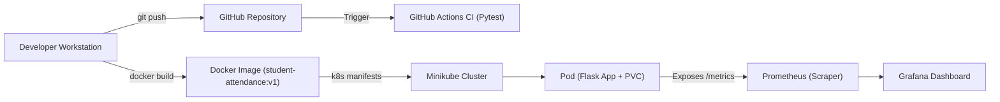

# Student Attendance Management System 🎓

> **B.Tech Computer Engineering — DevOps Mini-Project**  
> An end-to-end containerized and monitored web application built with **Flask**, **SQLite**, **Docker**, **Kubernetes (Minikube)**, **GitHub Actions**, **Prometheus**, and **Grafana**.

---

## 📑 Table of Contents
1. [Project Overview](#project-overview)
2. [DevOps Architecture](#devops-architecture)
3. [Technology Stack](#technology-stack)
4. [Folder Structure](#folder-structure)
5. [Stage 1 & 2: Local Application Setup](#stage-1--2-local-application-setup)
6. [Stage 3: Testing & CI Pipeline (GitHub Actions)](#stage-3-testing--ci-pipeline-github-actions)
7. [Stage 4: Containerization with Docker](#stage-4-containerization-with-docker)
8. [Stage 5: Kubernetes Orchestration (Minikube)](#stage-5-kubernetes-orchestration-minikube)
9. [Important: SQLite Limitations in Kubernetes](#important-sqlite-limitations-in-kubernetes)
10. [Stage 6: Monitoring with Prometheus & Grafana](#stage-6-monitoring-with-prometheus--grafana)
11. [Troubleshooting Guide](#troubleshooting-guide)
12. [Viva Questions & Model Answers](#viva-questions--model-answers)

---

## Project Overview

The **Student Attendance Management System** allows instructors and college administration to:
- **Register students** with unique roll numbers and names.
- **View student lists** in an organized, responsive dashboard.
- **Mark daily attendance** (Present / Absent) with date pickers and bulk-mark toggles.
- **Inspect attendance history** with date filters.
- **Expose real-time operational and business metrics** (`/metrics`) for site reliability monitoring.
- **Validate inputs** with friendly user feedback (flash alerts).

---

## DevOps Architecture



---

## Technology Stack

| Component | Tool / Technology | Purpose |
| :--- | :--- | :--- |
| **Backend** | Python 3.12 / 3.14 + Flask | Lightweight web framework & REST routes |
| **Frontend** | HTML5 + CSS3 (Vanilla) | Modern, responsive, dependency-free UI |
| **Database** | SQLite3 | Embedded single-file transactional database |
| **Testing** | Pytest | Automated unit & integration testing |
| **CI Pipeline** | GitHub Actions | Automated build & test execution on every commit |
| **Container** | Docker | Portable, multi-stage, non-root container packaging |
| **Orchestration** | Kubernetes (Minikube) | Declarative deployment, PVC, service discovery |
| **Metrics** | Prometheus Client | Exposes `/metrics` in standard OpenMetrics format |
| **Visualization** | Grafana | Live dashboard for throughput, latency, and student stats |

---

## Folder Structure

```
devops-project/
├── .github/
│   └── workflows/
│       └── ci.yml               # GitHub Actions CI workflow
├── app/
│   ├── __init__.py
│   ├── app.py                   # Flask server, routes, validation & metrics
│   ├── database.py              # SQLite connection, schema & init helpers
│   ├── static/
│   │   └── css/
│   │       └── style.css        # Clean responsive styles
│   └── templates/
│       ├── base.html            # Navigation and layout shell
│       ├── index.html           # Summary dashboard
│       ├── students.html        # Register & view students
│       ├── mark_attendance.html # Mark Present/Absent sheet
│       └── attendance_records.html # Attendance query logs
├── k8s/
│   ├── pvc.yaml                 # Persistent storage for SQLite
│   ├── deployment.yaml          # 1-replica Pod deployment with health probes
│   └── service.yaml             # NodePort service definition (port 30080)
├── monitoring/
│   ├── prometheus.yml           # Prometheus scrape configuration
│   ├── grafana-dashboard.json   # Pre-configured Grafana visual dashboard
│   └── docker-compose.monitoring.yml # Quick local monitoring stack runner
├── tests/
│   ├── __init__.py
│   └── test_app.py              # 9 comprehensive Pytest test cases
├── .dockerignore                # Excludes unwanted files from Docker build
├── .gitignore                   # Excludes venv, .db files, and caches
├── Dockerfile                   # Docker image blueprint (non-root security)
├── requirements.txt             # Python dependencies
└── README.md                    # Project documentation & viva guide
```

---

## Stage 1 & 2: Local Application Setup

### Prerequisites
- Python 3.10+ installed

### Steps

1. **Clone or navigate to the project directory:**
   ```bash
   cd "devops project"
   ```

2. **Create and activate a virtual environment:**
   - **Windows (PowerShell):**
     ```powershell
     python -m venv .venv
     .\.venv\Scripts\Activate.ps1
     ```
   - **Linux / macOS:**
     ```bash
     python3 -m venv .venv
     source .venv/bin/activate
     ```

3. **Install dependencies:**
   ```bash
   pip install -r requirements.txt
   ```

4. **Initialize database & launch the web application:**
   ```bash
   python -m app.app
   ```

5. **Access the application:**
   - Web UI: [http://localhost:5000](http://localhost:5000)
   - Health Probe: [http://localhost:5000/healthz](http://localhost:5000/healthz)
   - Prometheus Metrics: [http://localhost:5000/metrics](http://localhost:5000/metrics)

---

## Stage 3: Testing & CI Pipeline (GitHub Actions)

### Running Tests Locally with Pytest
Run the test suite with verbose output:
```bash
pytest -v
```
**Test Coverage:**
- Health check endpoint (`/healthz`)
- Prometheus metrics formatting (`/metrics`)
- Dashboard rendering
- Adding students with valid data
- Input validation (empty name / roll number)
- Duplicate roll number constraint rejection
- Marking attendance (Present / Absent)
- Upsert logic (updating attendance for the same day)

### Automated CI Pipeline (`.github/workflows/ci.yml`)
Whenever code is pushed to `main` or a pull request is created:
1. GitHub spins up an `ubuntu-latest` runner.
2. Clones the repository.
3. Sets up Python 3.12 with pip caching.
4. Installs `requirements.txt`.
5. Executes `pytest -v`.
6. Passes or fails the commit before deployment.

---

## Stage 4: Containerization with Docker

The application uses an optimized, secure Dockerfile based on `python:3.12-slim`:
- Runs under a dedicated unprivileged user (`appuser`, UID 1000).
- Uses built-in `HEALTHCHECK` checking `/healthz`.
- Environment variable `DATABASE_PATH=/app/data/attendance.db`.

### 1. Build the Docker Image
```bash
docker build -t student-attendance:v1 .
```

### 2. Run the Container with a Persistent Volume
```bash
docker run -d \
  --name student-attendance-app \
  -p 5000:5000 \
  -v attendance-data:/app/data \
  student-attendance:v1
```

### 3. Verify Container Status & Logs
```bash
docker ps
docker logs student-attendance-app
```

---

## Stage 5: Kubernetes Orchestration (Minikube)

The manifests in `k8s/` manage deployment on a Kubernetes cluster.

### 1. Start Minikube
```bash
minikube start
```

### 2. Point Local Docker CLI to Minikube's Docker Daemon
To use the local image `student-attendance:v1` without pushing to Docker Hub:
```bash
# On Windows PowerShell:
& minikube -p minikube docker-env --shell powershell | Invoke-Expression

# On Linux / macOS:
eval $(minikube docker-env)

# Build image inside Minikube's environment:
docker build -t student-attendance:v1 .
```

### 3. Apply Manifests
```bash
kubectl apply -f k8s/pvc.yaml
kubectl apply -f k8s/deployment.yaml
kubectl apply -f k8s/service.yaml
```

### 4. Check Pod, PVC & Service Status
```bash
kubectl get pods
kubectl get pvc
kubectl get svc
```

### 5. Access the Application in Minikube
```bash
minikube service student-attendance-service
```
*(Or use `kubectl port-forward svc/student-attendance-service 5000:5000`)*

---

## Important: SQLite Limitations in Kubernetes

> ⚠️ **Key Viva / Architecture Point:**

SQLite is a **serverless, file-backed database library** that coordinates concurrent transactions using file locks on the local filesystem.

### Limitations in Kubernetes:
1. **Single Replica Only (`replicas: 1`):**  
   If you scale a Deployment to 2+ pods sharing the same SQLite file over a network volume (NFS, AWS EFS, Ceph), simultaneous writes cause `database is locked` errors or file corruption because POSIX advisory locking is unreliable over distributed network filesystems.
2. **Access Mode (`ReadWriteOnce`):**  
   The PersistentVolumeClaim must use `ReadWriteOnce` (RWO), binding the volume to a single node.
3. **Deployment Strategy (`type: Recreate`):**  
   Rolling updates must be avoided; the old pod must terminate before the new pod mounts the volume to prevent dual-writer race conditions.

### Production Solution:
For high availability and horizontal scaling (`replicas: N`), migrate from SQLite to a client-server RDBMS such as **PostgreSQL** or **MySQL**, which handles connection pooling, row-level locking, and distributed client connections natively.

---

## Stage 6: Monitoring with Prometheus & Grafana

### Exposing Metrics
The application natively exposes metrics at `/metrics` using `prometheus-client`:
- `http_requests_total`: Total HTTP requests partitioned by HTTP method, route, and status code.
- `http_request_duration_seconds`: Histogram measuring response latency per endpoint.
- `attendance_students_total`: Live gauge of registered students in SQLite.
- `attendance_entries_marked_total`: Total attendance entries submitted (Present / Absent).

### Quick Local Monitoring Stack (Docker Compose)
A turnkey monitoring stack is provided in `monitoring/docker-compose.monitoring.yml`:

```bash
docker compose -f monitoring/docker-compose.monitoring.yml up -d
```

- **Prometheus UI:** [http://localhost:9090](http://localhost:9090)
  - Navigate to **Status** > **Targets** to confirm `student-attendance` is `UP`.
- **Grafana UI:** [http://localhost:3000](http://localhost:3000)
  - Login: `admin` / `admin`
  - Add Prometheus data source: `http://prometheus:9090`
  - Import dashboard: Go to **Dashboards** > **Import** > upload `monitoring/grafana-dashboard.json`.

---

## Troubleshooting Guide

| Issue | Cause | Resolution |
| :--- | :--- | :--- |
| `Port 5000 already in use` | Another instance of Flask or AirPlay/service is running | Stop the old process or change host port (e.g., `-p 5050:5000`) |
| `sqlite3.OperationalError: unable to open database file` | Permission denied or directory missing | Ensure `data/` directory exists and has write permissions for `appuser` (handled in Dockerfile via `chown`) |
| `Pod status: Pending (PVC)` | Minikube default storage provider not ready | Run `minikube addons enable default-storageclass` and `minikube addons enable storage-provisioner` |
| `ErrImageNeverPull` / `ImagePullBackOff` | Kubernetes trying to pull local image from Docker Hub | Set `imagePullPolicy: IfNotPresent` and build inside Minikube (`eval $(minikube docker-env)`) |
| `Prometheus target shows DOWN` | Target host unreachable from container | Use `host.docker.internal:5000` in `monitoring/prometheus.yml` |

---

## Viva Questions & Model Answers

### Q1: What is the role of DevOps in software engineering?
> **Answer:** DevOps bridges the gap between software development (Dev) and IT operations (Ops). It introduces automation, continuous integration and continuous deployment (CI/CD), infrastructure as code (IaC), containerization, and proactive monitoring to deliver high-quality software reliably and rapidly.

### Q2: Why did we containerize the application with Docker?
> **Answer:** Docker packages the application along with its dependencies, runtime, and configuration into an immutable container image. This eliminates the classic *"it works on my machine"* problem, ensuring consistent behavior across development, testing, and production environments.

### Q3: What is the purpose of GitHub Actions in this project?
> **Answer:** GitHub Actions serves as our Continuous Integration (CI) pipeline. On every code push or pull request, it automatically creates a fresh Linux virtual environment, installs project dependencies, and runs our Pytest suite. If any test fails, the commit is flagged, preventing buggy code from entering the main branch.

### Q4: Why is the deployment replica count set to 1 in Kubernetes?
> **Answer:** Because SQLite is an embedded single-file database. Multiple pods cannot safely write to the same SQLite file simultaneously over network storage without running into database lock exceptions or corruption. For scaling to multiple replicas, a client-server database like PostgreSQL would be required.

### Q5: What is the difference between a Kubernetes Pod, Deployment, and Service?
> **Answer:**
> - **Pod:** The smallest deployable unit in Kubernetes, running one or more containers.
> - **Deployment:** A declarative controller that manages the lifecycle, desired replica count, and updates of Pods.
> - **Service:** An abstraction that provides a stable network IP address and DNS name to route traffic to ephemeral Pods.

### Q6: What are Liveness and Readiness probes?
> **Answer:**
> - **Readiness Probe:** Checks if the container is ready to accept incoming user traffic. If it fails, Kubernetes removes the pod from the Service endpoints.
> - **Liveness Probe:** Checks if the container is alive and functioning. If it fails, Kubernetes automatically kills and restarts the pod to recover from deadlocks.

### Q7: Why do we use a PersistentVolumeClaim (PVC) for SQLite?
> **Answer:** Containers are ephemeral by default; when a container restarts or is rescheduled, any file written inside its container layer is lost. A PersistentVolumeClaim (PVC) provisions durable storage decoupled from the pod lifecycle, ensuring the SQLite database file persists across pod restarts and deployments.

### Q8: What metrics are collected by Prometheus in our app?
> **Answer:**
> 1. `http_requests_total`: Tracks the volume of requests across endpoints and HTTP status codes (200, 404, 500).
> 2. `http_request_duration_seconds`: Measures request latency using a histogram.
> 3. `attendance_students_total`: Application-level gauge tracking the total number of registered students.
> 4. `attendance_entries_marked_total`: Counter tracking total attendance records marked (Present/Absent).

### Q9: Why is running the container as a non-root user important?
> **Answer:** Running as a non-root user (`appuser` with UID 1000) follows the principle of least privilege. In the event of a container breakout vulnerability, the attacker gains only unprivileged user access rather than root access to the host machine.

### Q10: How does Grafana communicate with Prometheus?
> **Answer:** Grafana uses Prometheus as a time-series data source. Grafana sends PromQL (Prometheus Query Language) queries over HTTP (port 9090) to Prometheus, which aggregates and returns time-series metrics that Grafana plots visually on graphs and stat panels.

---
*Created as part of the B.Tech Computer Engineering DevOps Curriculum.*
